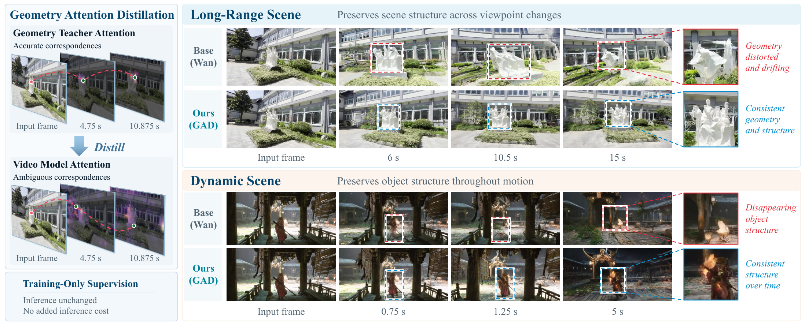

<h2 align="center">
  <b>GAD: Geometry Attention Distillation for Consistent Video Generation</b>
</h2>

<p align="center">
  <b>Junfeng Ni</b><sup>1,2,3,*</sup>,
  <b>Ziyu Zhu</b><sup>2,*</sup>,
  <b>Fan Jiang</b><sup>2,*,†,✉</sup>,
  <b>Yu Liu</b><sup>1</sup>,
  <b>Chiyu Wang</b><sup>2</sup>,
  <b>Jiawei Zhang</b><sup>2</sup>,
  <b>Zhaoxu Sun</b><sup>2</sup>,
  <b>Mu Xu</b><sup>2</sup>,
  <b>Siyuan Huang</b><sup>3,✉</sup>,
  <b>Yixin Chen</b><sup>3,✉</sup>
  <br>
  <sup>*</sup> Equal contribution &nbsp;
  <sup>†</sup> Project leader &nbsp;
  <sup>✉</sup> Corresponding author
  <br>
  <sup>1</sup>Tsinghua University &nbsp;
  <sup>2</sup>AMAP, Alibaba Group
  <br>
  <sup>3</sup>State Key Laboratory of General Artificial Intelligence, BIGAI
</p>

<p align="center">
  <a href="https://arxiv.org/abs/2610.18779"></a>
  <a href="https://fantasy-amap.github.io/GAD/"></a>
</p>

<p align="center">
  
</p>

## Overview

Video diffusion models can generate visually compelling short clips, but often
struggle to preserve scene geometry and object structure over time. We introduce
**Geometry Attention Distillation (GAD)**, a training framework that transfers
cross-frame correspondences from a frozen geometry model into video-model
attention.

GAD extracts correspondence targets from VGGT-Ω attention on clean training
videos. It applies confidence-aware pairwise and trackwise supervision to a
student attention layer selected according to the diffusion timestep. This
timestep-routed supervision helps the video model form reliable cross-frame
associations for both static surfaces and moving objects.

The geometry teacher and distillation objectives are used only during training.
Inference retains the original video-model architecture and sampling procedure,
with no additional inference modules or computational overhead.

Experiments on camera-controlled video generation show improved long-range scene
consistency and dynamic object consistency across multiple video backbones. On
Wan2.2 5B, GAD improves cross-frame matching accuracy by at least 30% over the Wan
baseline on both long-range benchmarks.

## Release Plan

- [x] Release the project page
- [x] Release the paper
- [ ] Release VGGT-Ω attention-label extraction code
- [ ] Release GAD training and inference code
- [ ] Release model checkpoints
- [ ] Release example data and usage documentation


## Acknowledgements

This project builds on
[DiffSynth-Studio](https://github.com/modelscope/DiffSynth-Studio),
[Wan](https://github.com/Wan-Video/Wan2.1),
[VideoX-Fun](https://github.com/aigc-apps/VideoX-Fun), and
[VGGT-Ω](https://github.com/facebookresearch/vggt-omega). We thank the authors
for making their work publicly available.

## Citation

If you find GAD useful for your research, please cite:

```bibtex
@article{ni2026gad,
  title={GAD: Geometry Attention Distillation for Consistent Video Generation},
  author={Ni, Junfeng and Zhu, Ziyu and Jiang, Fan and Liu, Yu and Wang, Chiyu and Zhang, Jiawei and Sun, Zhaoxu and Xu, Mu and Huang, Siyuan and Chen, Yixin},
  journal={arXiv preprint arXiv:2610.18779},
  year={2026}
}
```

